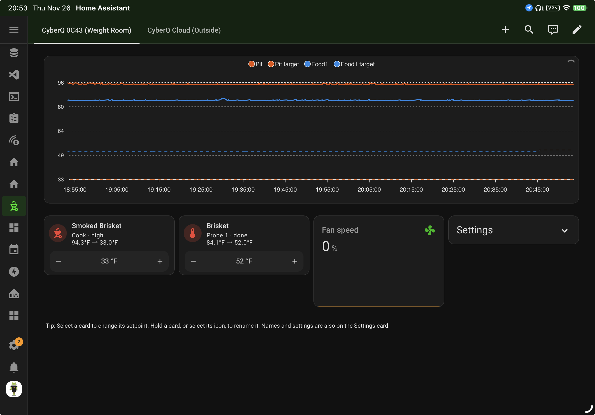
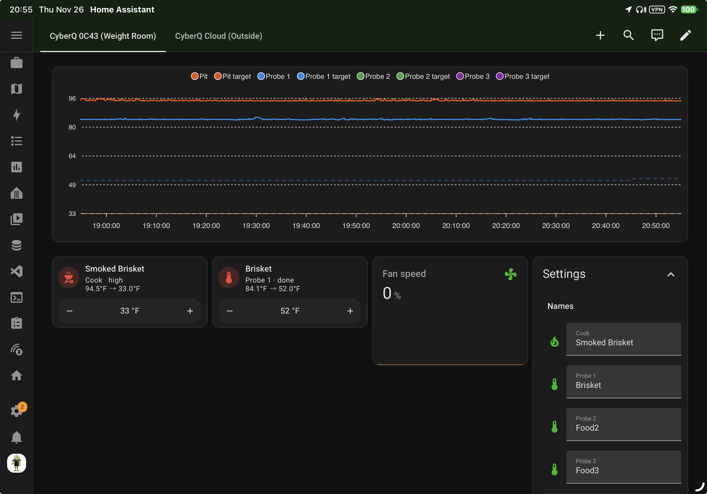
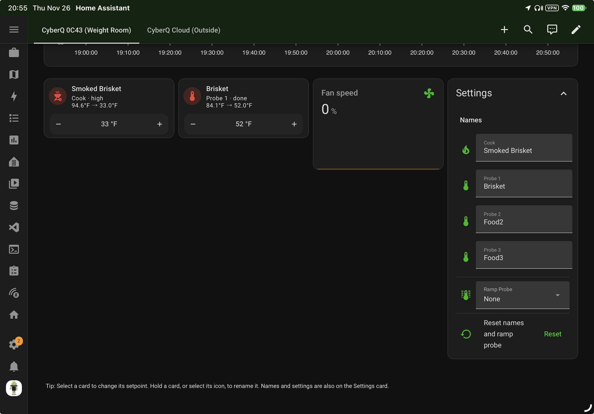
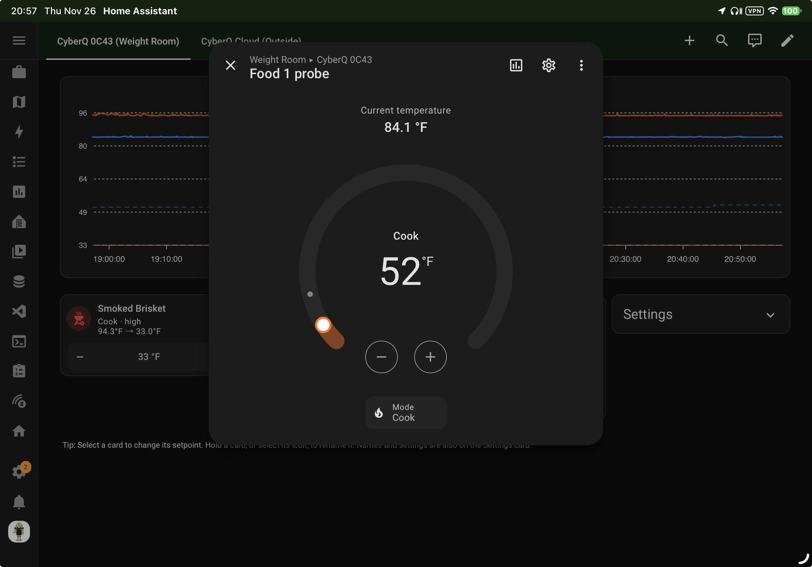
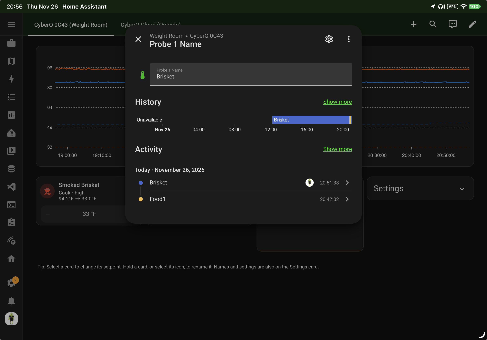

# ![Logo][logo] HomeAssistant Integration for BBQ Guru Cyberq Cloud and Cyberq WiFi

[![GitHub Release][releases-shield]][releases]
[![GitHub Activity][commits-shield]][commits]
[![License][license-shield]](LICENSE)

![Project Maintenance][maintenance-shield]

[![Community Forum][forum-shield]][forum]

The [ha_cyberq] integration is used to integrate the [BBQ
Guru][bbq_guru] CyberQ Cloud and CyberQ WiFi automatic BBQ temperature controllers.

The BBQ Guru CyberQ Cloud and WiFi are discontinued products.
Information about these controllers can be found on the [BBQ Guru
Support Pages][bbq_guru_support]

This integration aims to enable complete control of these temperature
controllers as well as replace the need for the BBQ Guru Cloud.

## Supported Devices

Only the following devices are supported by this integration.

- CyberQ WiFi firmware version 4.08
- CyberQ Cloud firmware version 1.7

**This integration will set up the following platforms.**

<!-- markdownlint-disable MD013 -->
| Platform        | CyberQ sensors supported                                                                                 |
|-----------------|----------------------------------------------------------------------------------------------------------|
| `binary_sensor` | `FAN_SHORTED`                                                                                            |
| `climate`       | `COOK_TEMP`, `COOK_SET`, `FOOD1_TEMP`, `FOOD1_SET`, `FOOD2_TEMP`, `FOOD2_SET`, `FOOD3_TEMP`, `FOOD3_SET` |
| `number`        | `COOK_PROPBAND`, `COOK_CYCTIME`, `ALARMDEV`, `LCD_BACKLIGHT`, `LCD_CONTRAST`, `COOKHOLD`                 |
| `select`        | `COOK_RAMP`, `DEG_UNITS`, `ALARM_BEEPS`, `TIMEOUT_ACTION`                                                |
| `sensor`        | `FAN_SPEED`, `COOK_STATUS`, `FOOD1_STATUS`, `FOOD2_STATUS`, `FOOD3_STATUS`, `TIMER_STATUS`, `TIMER_CURR` |
| `switch`        | `OPENDETECT`, `MENU_SCROLLING`, `KEY_BEEPS`                                                              |
| `text`          | `COOK_NAME`, `FOOD1_NAME`, `FOOD2_NAME`, `FOOD3_NAME`                                                    |
<!-- markdownlint-enable MD013 -->

## Installation

### The easy way

Add this repository to your HACS with the following button:

[](https://my.home-assistant.io/redirect/hacs_repository/?owner=jchonig&repository=ha_cyberq&category=integration)

Install this integration with the following button:

[](https://my.home-assistant.io/redirect/config_flow_start/?domain=cyberq)

### Manual installation

1. Using the tool of choice open the directory (folder) for your HA
   configuration (where you find `configuration.yaml`).
1. If you do not have a `custom_components` directory (folder) there,
   you need to create it.
1. In the `custom_components` directory (folder) create a new folder called `cyberq`.
1. Download _all_ the files from the `custom_components/cyberq/`
   directory (folder) in this repository.
1. Place the files you downloaded in the new directory (folder) you created.
1. Restart Home Assistant
1. In the HA UI go to "Configuration" -> "Integrations" click "+" and
   search for "CyberQ"

## Prerequisites

1. Follow the instructions for your device found on the [BBQ Guru
Support Pages][bbq_guru_support] to connect your device to your WiFi
network in Infrastructure Mode.
1. Make note of the IP address and port number (defaults to 80) of
   your CyberQ.

## Configuration

In the HA UI go to "Settings" -> "Devices & services", click "Add
integration" and search for "CyberQ". Enter the following:

- **Host**: the hostname or IP address of your CyberQ.
- **Port**: the port the CyberQ web server listens on (defaults to 80).

## Data updates

This integration fetches data from the device every 5 seconds by
default.
The internal webserver of the CyberQ devices fetches data every 1
second, however HomeAssistant has a lower limit on the update
interval of 1 second.

## Actions

`cyberq.reset_cook` sets the cook and probe names back to Cook,
Food1, Food2 and Food3, and the ramp probe to None, ready for the
next cook. The CyberQ needs a name of at least one character, so
names are reset to these defaults rather than cleared.

| Field | Required | Description |
| --- | --- | --- |
| `device_id` | yes | The CyberQ to reset |

```yaml
action: cyberq.reset_cook
data:
  device_id: 0123456789abcdef0123456789abcdef
```

The CyberQ handles one request at a time, so the action sends all
the names in one request and the ramp probe in a second one.

## Notifications

Install the following blueprint to configure notifications from the
CyberQ

[](https://my.home-assistant.io/redirect/blueprint_import/?blueprint_url=https%3A%2F%2Fraw.githubusercontent.com%2Fjchonig%2Fha_cyberq%2Frefs%2Fheads%2Fmain%2Fblueprints%2Fautomation%2Fcyberq_alert.yaml)

## Dashboard

The integration includes a dashboard strategy that builds one view
per CyberQ: a temperature graph, a card each for the cook and the
plugged-in probes, the fan speed, and settings. The integration
loads it automatically; no Lovelace resource is needed.

To add the dashboard:

1. Go to **Settings** → **Dashboards** → **Add dashboard** → **New
   dashboard from scratch**, and give it a title and icon.
2. Open the new dashboard, select the pencil (edit), then the
   three-dot menu → **Raw configuration editor**.
3. Replace the contents with the following and save:

```yaml
strategy:
  type: custom:cyberq
```

Each view is titled with the device name and its area. The cook
and probe names and the other settings are on the **Settings**
card, which folds to its title; select the title to open or close
it. Each browser remembers whether it is open. **Reset** on that
card runs the [`cyberq.reset_cook`](#actions) action; press it
again within five seconds to confirm.

The cards work with core Home Assistant alone, and use these
frontend cards when they are installed:

- [Mushroom](https://github.com/piitaya/lovelace-mushroom): one
  card per cook and probe with the assigned name, status, and the
  temperature colored by how close it is to the setpoint. Select
  the card to open the thermostat; select the icon or hold the
  card to rename it.
- [ApexCharts Card](https://github.com/RomRider/apexcharts-card):
  graph with time and temperature axes and dashed setpoint lines.
  Without it, [mini-graph-card](https://github.com/kalkih/mini-graph-card)
  is used, or the core history graph.

Tips at the bottom of the view explain the card gestures and name
any of these cards that are not installed from the Marketplace.

Probes that are unplugged when the dashboard loads are left out,
and the card widths are chosen for the number of probes in use.
Reload the dashboard after plugging in or removing a probe.

## Known limitations

- The CyberQ Cloud and CyberQ WiFi are discontinued and will not
  receive firmware updates. Only the firmware versions listed under
  [Supported Devices](#supported-devices) are supported.

See [Issues][issues] for other known problems.

## Removing the integration

This integration follows standard integration removal. No extra
steps are required.

## Screenshots

- The dashboard, with the Settings card collapsed

- The Settings card open, with the cook and probe names

- The rest of the Settings card: ramp probe and Reset

- Setting a probe target temperature

- Renaming a probe


<!---->

## Contributions are welcome

If you want to contribute to this please read the [Contribution guidelines](CONTRIBUTING.md)

***

[bbq_guru]: https://www.bbqguru.com
[bbq_guru_support]: https://www.bbqguru.com/support/
[commits-shield]: https://img.shields.io/github/commit-activity/y/jchonig/ha_cyberq?style=for-the-badge
[commits]: https://github.com/jchonig/ha_cyberq/commits/main
[forum-shield]: https://img.shields.io/badge/community-forum-brightgreen.svg?style=for-the-badge
[forum]: https://community.home-assistant.io/t/cyberq-bbq-guru-cyberq-cloud-and-wi-fi-integration/815570
[ha_cyberq]: https://github.com/jchonig/ha_cyberq
[issues]: https://github.com/jchonig/ha_cyberq/issues
[license-shield]: https://img.shields.io/github/license/jchonig/ha_cyberq.svg?style=for-the-badge
[logo]: https://brands.home-assistant.io/cyberq/icon.png
[maintenance-shield]: https://img.shields.io/badge/maintainer-Jeffrey%20Honig%20%40jchonig-blue.svg?style=for-the-badge
[releases-shield]: https://img.shields.io/github/release/jchonig/ha_cyberq.svg?style=for-the-badge
[releases]: https://github.com/jchonig/ha_cyberq/releases
